<div align="center">

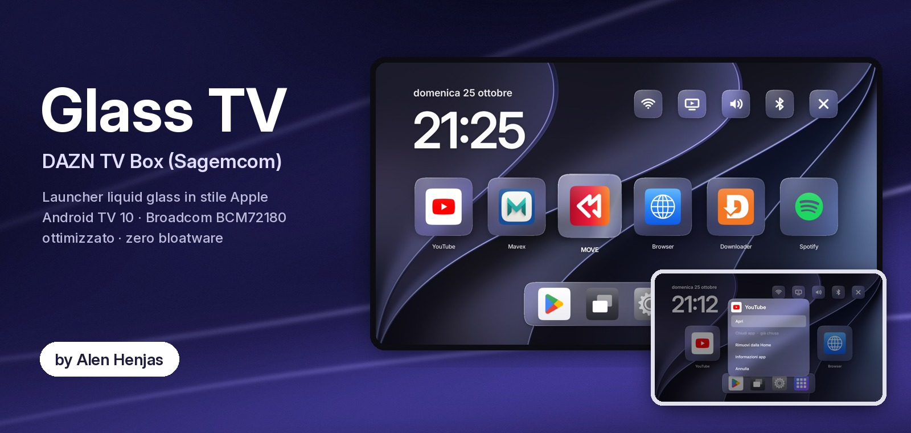

# Glass TV · DAZN TV Box

**Il DAZN TV Box (Sagemcom DTIW3930) trasformato in un box Android TV veloce, pulito e con un'interfaccia liquid glass in stile Apple, scritta da zero.**


Progettato e sviluppato da **[Alen Henjas](https://github.com/alenhenjas)**

[Funzionalità](#-funzionalità) · [Schermate](#-schermate) · [Ottimizzazioni](#%EF%B8%8F-ottimizzazioni-del-box) · [Prestazioni](#-prestazioni) · [Installazione](#-installazione) · [Versioni](CHANGELOG.md) · [Roadmap](ROADMAP.md)

</div>

---

> **English summary** — The DAZN TV Box is a locked-down Sagemcom set-top box (Android TV 10, Broadcom BCM72180) sold for a single streaming service. I profiled it over ADB, tuned and debloated it, and wrote *Glass TV*: a hand-crafted Apple-style "liquid glass" launcher in pure Java (no libraries, ~5,600 lines, ~1 MB APK) with a glass control center (Wi-Fi, video/50 Hz, audio, Bluetooth), an iPad-style app switcher with live previews, a remote-friendly web browser, a customizable lock-screen clock, power/restart controls and a volume HUD. Settings that only exist in the vendor's hidden pages (resolution, 50 Hz) are driven by an accessibility service behind a glass cover. No root, fully reversible. This is where the project started; it was later ported to the [Xiaomi TV Box S](https://github.com/alenhenjas/glass-tv-xiaomi).

## ✨ In breve

| | |
|---|---|
| 🧊 **Liquid glass vero** | vetro con sfondo sfocato ritagliato, bordo che rifrange, riflesso speculare e scia di luce al focus, tutto disegnato a mano |
| ⚡ **Fluido** | motore grafico con cache condivise: frame peggiori da 250 ms a 48 ms |
| 🎛️ **Impostazioni nascoste sbloccate** | risoluzione e 50 Hz Sagemcom applicati in automatico sotto una scheda in vetro |
| 🧹 **Box ripulito** | 13 componenti inutili disattivati, launcher Google sostituito |
| 🔓 **Senza root** | solo ADB e un servizio di accessibilità; tutto reversibile |

## 🚀 Funzionalità

### Home
- **Orologio in stile lockscreen** personalizzabile: colore, stile (pieno, liquid glass, vetro trasparente, contorno), opacità, carattere, dimensione, data.
- **Griglia adattiva** che si riorganizza in base al numero di app: tutto sempre visibile.
- **Icone in vetro** con ingrandimento a curva Apple e scia di luce.
- **Dock** con Play Store, App aperte, Impostazioni, Tutte le app.
- **Spegni** (standby + TV via HDMI-CEC) e **Riavvia** con conferma in vetro.

### Centro di controllo
- **Wi-Fi** con elenco reti, connessione con password e dimentica rete.
- **Video**: risoluzione (automatica, 4K, 1080p, 720p) e **adattamento a 50 Hz** per TV e sport italiani, applicati nella pagina nascosta Sagemcom.
- **Audio**: volume, formato (automatico, PCM, Dolby/surround), suoni dei tasti.
- **Bluetooth** con protezione del telecomando.
- **Chiudi tutto** con la memoria liberata.

### App e sistema
- **Menu della pressione lunga**: Apri, Chiudi app (rossa/grigia), Aggiungi/Rimuovi dalla Home, Informazioni.
- **App aperte** in stile iPad con anteprime reali.
- **Browser** stile Chrome per telecomando con puntatore, scorrimento e blocco pubblicità.
- **Indicatore del volume** in vetro intercettando i tasti del telecomando.
- **Impostazioni** in vetro stile iPad.

## 🖼️ Schermate

| | |
|:---:|:---:|
| 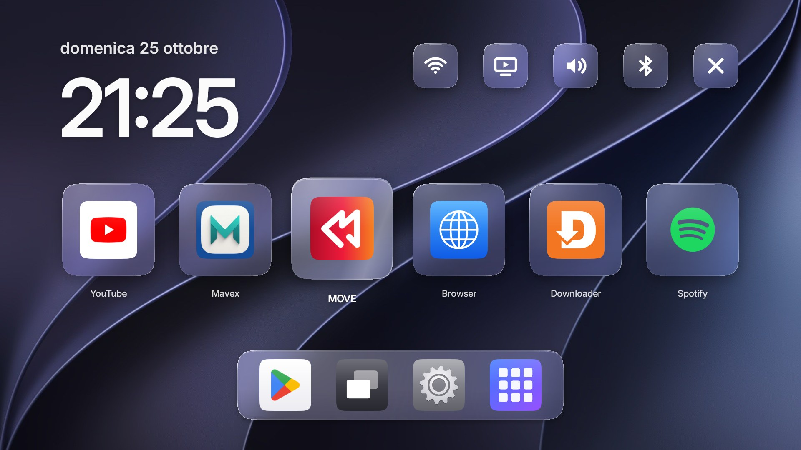<br/>**Home** | 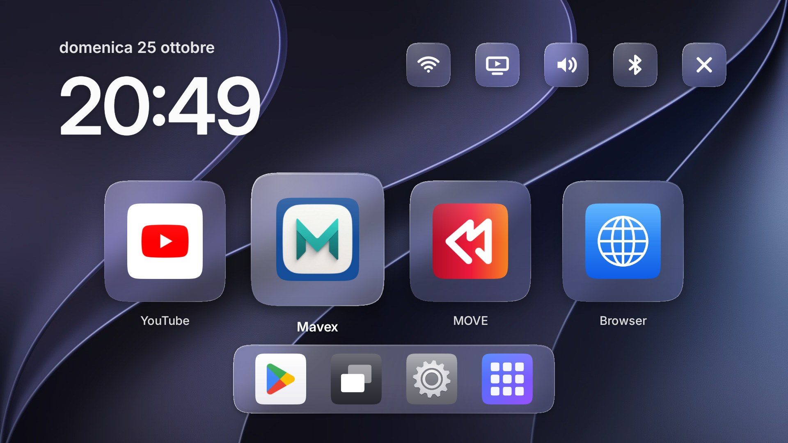<br/>**Focus con vetro e scia di luce** |
| 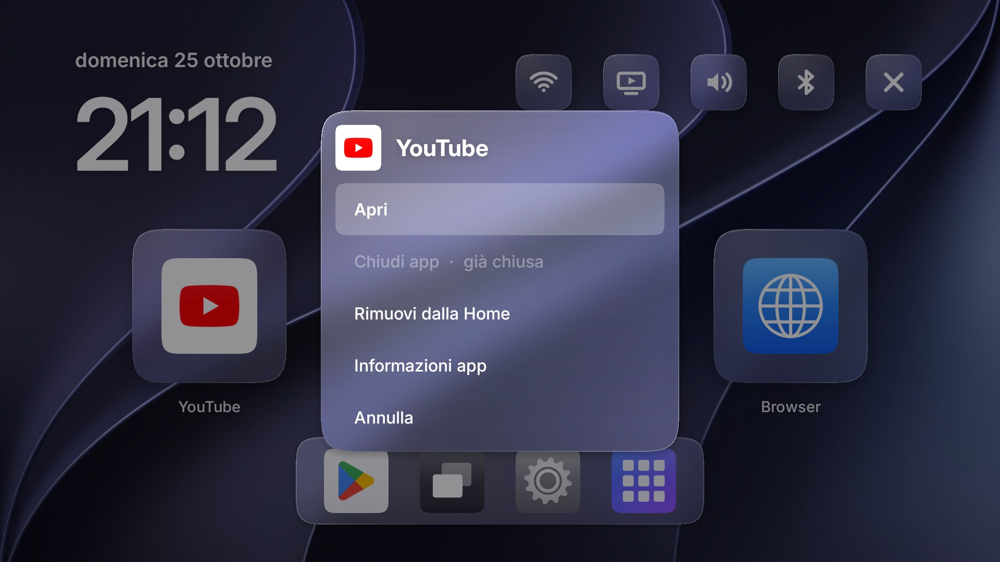<br/>**Menu della pressione lunga** | 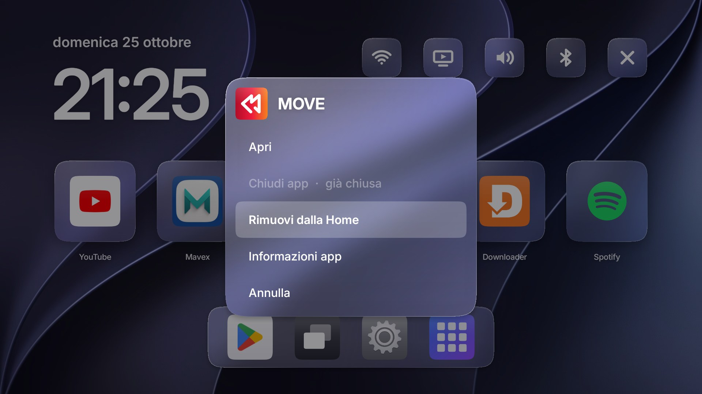<br/>**Rimuovi dalla Home** |
| 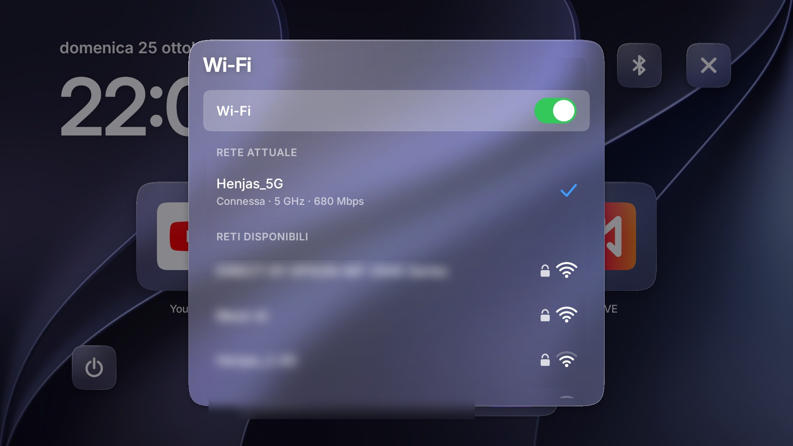<br/>**Wi-Fi** | 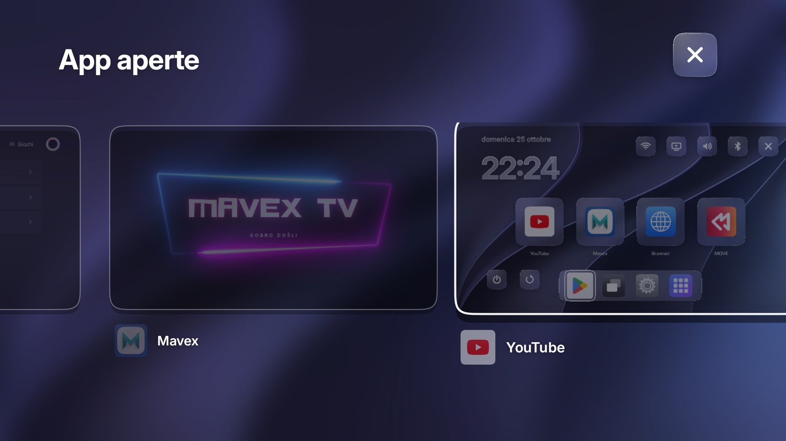<br/>**App aperte con anteprime** |
| 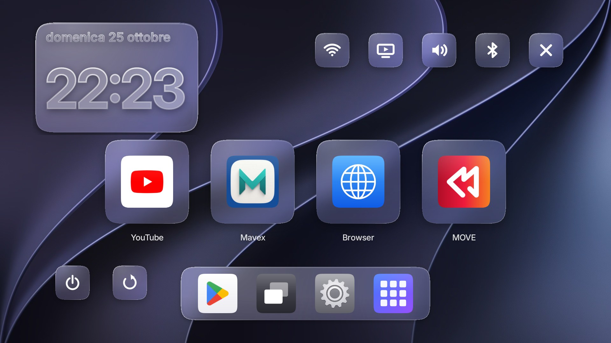<br/>**Orologio liquid glass** | 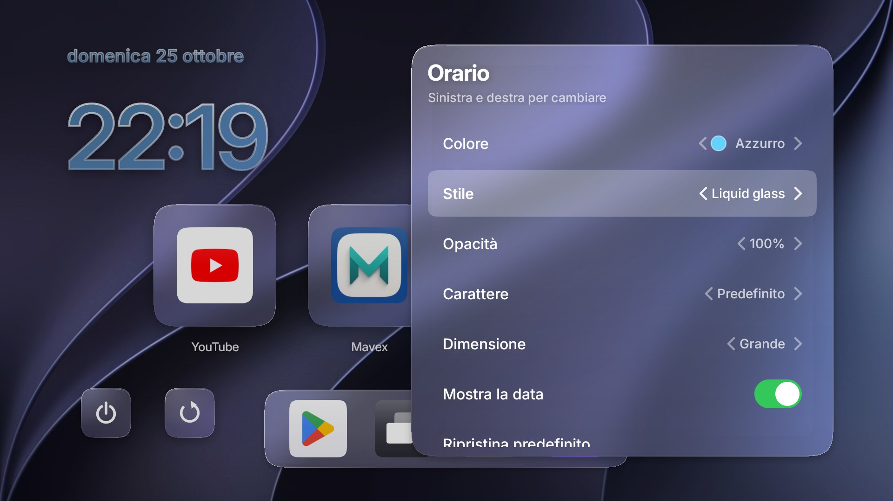<br/>**Personalizzazione dell'orologio** |
| 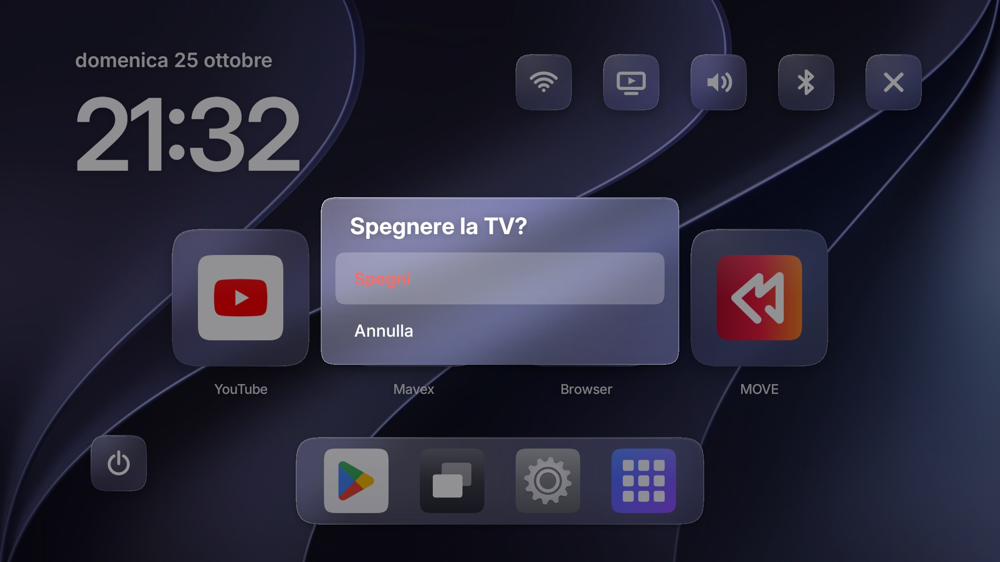<br/>**Spegni la TV** | 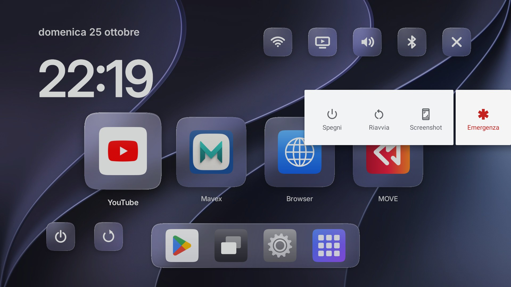<br/>**Menu di accensione usato per il riavvio** |

## 🔬 Il dispositivo

| | DAZN TV Box |
|---|---|
| Modello | Sagemcom DTIW3930 (`m393gena_dazn`) |
| Sistema | Android TV 10 (SDK 29), boot verificato, bootloader bloccato |
| SoC | Broadcom BCM72180 |
| RAM | 2,7 GB |
| Spazio utente | 6,3 GB |
| App | userspace a 32 bit (`armeabi-v7a`) |
| Uscita | 1080p / 4K, 50 Hz configurabile solo da pagina nascosta del produttore |
| Rete | Ethernet e Wi-Fi |
| HDMI-CEC | sì (disattivato di fabbrica) |

## ⚙️ Ottimizzazioni del box

| Impostazione | Prima | Dopo | Perché |
|---|---|---|---|
| Animazioni finestre / transizioni / app | 1.0 / 0 / 0 | 0.35 / 0.35 / 0.5 | animazioni visibili ma rapidissime |
| Scansioni Wi-Fi e Bluetooth in background | attive | spente | meno carico |
| HDMI-CEC | spento | acceso | Glass spegne anche la TV |
| Cache app | piene | pulite | spazio e avvio più rapido |
| Compilazione app | parziale | AOT completa (`bg-dexopt-job`) | app più veloci all'avvio |
| App di sistema inutili | attive | **13 disattivate** (reversibile) | meno processi in RAM |
| Home | launcher Google TV | **Glass TV** | interfaccia nuova |

## 📈 Prestazioni

Misure con `dumpsys gfxinfo` ripetendo la stessa sequenza (spostamento tra le app, apertura del popup Wi-Fi, apertura delle Impostazioni):

| | Prima | Dopo |
|---|---:|---:|
| Frame tipico (50° percentile) | 8 ms | 9 ms |
| 95° percentile | 57 ms | 38 ms |
| 99° percentile | 250 ms | **48 ms** |
| Scatto massimo all'apertura dei popup | ~300 ms | **~50 ms** |

Il guadagno viene dal motore liquid glass riscritto: ombre a 1/4 di risoluzione in cache condivisa, riflessi pre-disegnati e creati solo quando servono, elenco dei processi preparato in background.

## 🧠 Architettura

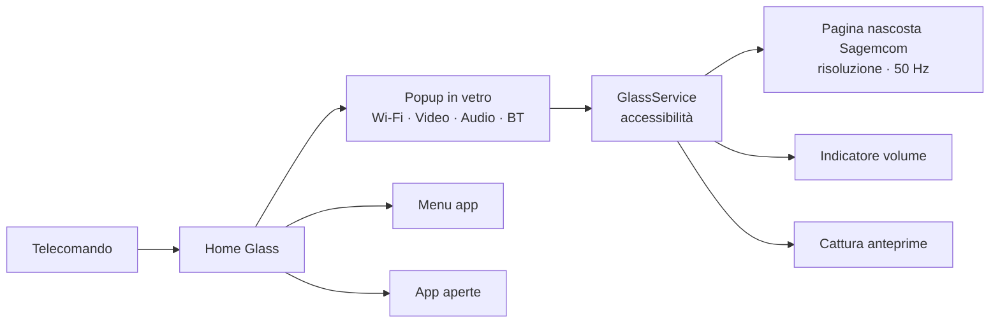

- **28 classi Java, ~5.600 righe, zero dipendenze**, ogni elemento disegnato a mano su `Canvas`.
- **Automazione senza root** della pagina `AvIoSettingsActivity` di Sagemcom: risoluzione e 50 Hz si applicano da Glass mentre una scheda in vetro copre la pagina Android.
- **Filtro dei tasti** del servizio di accessibilità per l'indicatore del volume e per catturare l'anteprima dell'app quando si preme Home.

Approfondimento completo in **[docs/ARCHITETTURA.md](docs/ARCHITETTURA.md)**.

## 📦 Installazione

PC Windows sulla stessa rete del box; script in [`scripts/`](scripts/), avvio con doppio clic.

1. Sul box: **Impostazioni → Preferenze dispositivo → Info →** 7 volte su *Build*.
2. **Opzioni sviluppatore → Debug USB: ON**; annota l'IP del box.
3. `01_adb.bat` → `02_connetti.bat` (conferma "Consenti sempre" sulla TV).
4. `03_analisi.bat` *(facoltativo)* → `04_ottimizza.bat` → `05_debloat.bat`.
5. `06_installa_glass.bat` installa [`release/GlassTV.apk`](release/), concede i permessi e imposta Glass come home.

Ripristino completo: `99_ripristino.bat`. Dopo un aggiornamento di Glass: `07_riattiva_servizio.bat`.

```bash
./gradlew assembleRelease        # compilare dal sorgente (JDK 17+, Android SDK 34)
```

## 🗂️ Struttura

```
glass-tv-dazn/
├── app/src/main/java/com/alen/glass/   launcher, motore glass, popup, servizio
├── app/src/main/res/                   caratteri Inter, sfondo, animazioni
├── scripts/                            kit di installazione e ottimizzazione
├── release/GlassTV.apk                 build pronta
├── docs/                               architettura, schermate, banner
├── CHANGELOG.md · ROADMAP.md
```

## 🛣️ Evoluzione

Questo è il box su cui Glass TV è nato: prima l'analisi e la pulizia del sistema, poi il launcher, il browser, il centro di controllo, le impostazioni in vetro, la home personalizzabile, il motore grafico più veloce, l'orologio personalizzabile, spegni e riavvia. Da qui il progetto è stato portato sullo [Xiaomi TV Box S](https://github.com/alenhenjas/glass-tv-xiaomi).
Storia completa in **[CHANGELOG.md](CHANGELOG.md)**, prossimi passi in **[ROADMAP.md](ROADMAP.md)**. Continuerò a migliorarlo nel tempo.

## 👤 Autore

**Alen Henjas** — Studente di Ingegneria Informatica · UNIMORE
Ho ideato, progettato e sviluppato Glass TV: analisi del dispositivo, interfaccia, motore grafico, servizio di sistema, ottimizzazioni e documentazione.
[github.com/alenhenjas](https://github.com/alenhenjas)

## 📄 Licenza

[MIT](LICENSE) · componenti di terze parti in [NOTICE.md](NOTICE.md).
Progetto indipendente, non affiliato a DAZN, Sagemcom, Google o Apple.

<div align="center"><sub>Glass TV · © 2026 Alen Henjas</sub></div>
