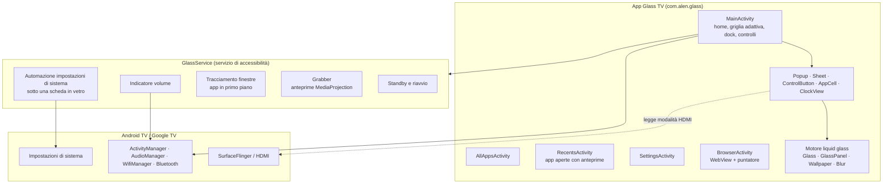

# Architettura di Glass TV

Glass TV è un'app Android nativa scritta in **Java puro**, senza librerie esterne né AndroidX:
circa **5.600 righe** in 28 classi, APK da ~1 MB. Ogni elemento grafico è disegnato a mano su `Canvas`
per avere il controllo totale su effetto vetro, animazioni e prestazioni anche su box TV da 2 GB di RAM.

> Progettata e sviluppata da **Alen Henjas**.

## Schema generale

## Moduli

| File | Righe | Responsabilità |
|---|---:|---|
| `MainActivity` | 472 | Home: orologio, controlli rapidi, griglia app adattiva, dock, spegni/riavvia, navigazione del focus esplicita |
| `Glass` | 208 | Pittore liquid glass: ombra, sfondo sfocato ritagliato, bordo che rifrange, tinta, riflesso speculare, scia di luce |
| `GlassPanel` | 30 | Contenitore in vetro per dock, popup e schede |
| `Wallpaper` / `Blur` | 145 / 97 | Sfondo a schermo intero e sua versione sfocata e satura (cache su disco) |
| `AppCell` | 147 | Icona app disegnata a mano: vetro, icona squircle, etichetta, ingrandimento con curva Apple, pressione lunga |
| `ControlButton` / `Glyphs` | 61 / 173 | Pulsanti rotondi in vetro e glifi vettoriali (Wi-Fi, video, audio, Bluetooth, spegni, riavvia…) |
| `ClockView` | 317 | Orologio personalizzabile: colore, stile (pieno, liquid glass, vetro, contorno), opacità, carattere, dimensione |
| `Popup` | 379 | Popup in vetro con righe, interruttori, selettori "‹ valore ›", trappola del focus |
| `Sheet` | 197 | Menu contestuale e avvisi in vetro; impedisce menu sovrapposti |
| `Controls` | 614 | Wi-Fi, Bluetooth, Audio e Video (Sagemcom e Xiaomi) |
| `AppMenu` | 98 | Menu della pressione lunga: Apri, Chiudi, Aggiungi/Rimuovi dalla Home, Informazioni |
| `Home` / `Apps` / `Icons` | 49 / 158 / 227 | Elenco app della home, app installate, icone ad alta risoluzione |
| `Closer` / `Running` / `Recents` | 91 / 53 / 63 | Chiusura app, elenco processi (cache), ordine d'uso e anteprime |
| `RecentsActivity` | 230 | App aperte in stile iPad |
| `SettingsActivity` | 234 | Impostazioni in vetro |
| `BrowserActivity` / `AdBlock` | 615 / 49 | Browser stile Chrome per telecomando con blocco pubblicità |
| `GlassService` | 526 | Servizio di accessibilità: volume, automazione impostazioni, finestre, standby, riavvio |
| `Grabber` | 104 | Cattura dello schermo a 640×360 per le anteprime del multitasking |
| `Sys` / `Ui` | 53 / 89 | Comandi di sistema, rilevamento dispositivo, caratteri e curve di animazione |

## Il motore liquid glass

Android 10/11 sui box TV non offre la sfocatura dello sfondo delle finestre, quindi l'effetto vetro è ricostruito a mano:

1. **Sfondo sfocato precalcolato** — all'avvio lo sfondo viene ridotto a 1/6, sfocato e saturato una volta sola e salvato su disco.
2. **Ritaglio per posizione** — ogni pannello disegna la porzione di sfondo sfocato che si trova esattamente dietro di sé (`getLocationInWindow` + matrice di scala), compensando anche l'ingrandimento del focus.
3. **Rifrazione del bordo** — sul bordo il vetro mostra lo sfondo ingrandito del 3,5% (`clipOutPath` sul contorno interno), come una lente.
4. **Strati di luce** — tinta lattiginosa, luce diffusa radiale in alto a sinistra, ombra interna in basso, bordo speculare a gradiente e filo di luce sul lato alto.
5. **Forma squircle** — angoli a superellisse (esponente ~5) come le icone Apple, non semplici rettangoli arrotondati.

### Prestazioni

- Ombre calcolate a **1/4 di risoluzione** (sono sfocate: la differenza non si vede) e messe in una **cache condivisa** per forma e dimensione: tutte le icone uguali usano la stessa bitmap.
- Riflessi pre-disegnati in bitmap condivise e create solo al primo uso: per ogni frame restano pochi `drawBitmap`.
- Animazioni solo su proprietà di render (`scale`, `alpha`): niente nuovi layout durante il movimento.
- Elenco dei processi in esecuzione preparato in background, così i menu si aprono all'istante.

Misure con `dumpsys gfxinfo` sulla stessa sequenza di tasti:

| | Prima | Dopo |
|---|---:|---:|
| Frame tipico (50° percentile) | 8 ms | 9 ms |
| 99° percentile | 250 ms | **48 ms** |
| Scatto massimo all'apertura dei popup | ~300 ms | **~50 ms** |

## Soluzioni tecniche interessanti

- **Automazione delle impostazioni di sistema senza root** — risoluzione, 50 Hz, Dolby Vision e riavvio vivono in pagine di sistema non accessibili alle app. Il servizio di accessibilità le apre, preme le voci giuste e conferma, il tutto sotto una scheda in vetro che copre la pagina Android. Supporta voci composte (`1080p&60Hz`), passi di sola selezione (`~Risoluzione`), finestre sovrapposte (conferme di tipo overlay) e pagine *slice* visitando l'intero albero dei nodi.
- **Uscita HDMI reale** — l'interfaccia Android dei box è sempre 1080p anche in 4K: la modalità effettiva si legge da SurfaceFlinger.
- **Trappola del focus** — popup e menu limitano la ricerca della voce successiva al proprio pannello (`FocusFinder` sul solo overlay), così il focus non può finire dietro e lasciare un popup orfano.
- **Pressione lunga unica** — il tasto OK è gestito interamente dalla vista (niente timer di sistema), quindi tenendo premuto a lungo si apre un solo menu.
- **Volume** — sul DAZN box i tasti volume vengono filtrati dal servizio; sullo Xiaomi il window manager li consuma prima del filtro, quindi l'indicatore segue `VOLUME_CHANGED_ACTION`.
- **Anteprime del multitasking** — token MediaProjection approvato una volta via `appops`, cattura a 640×360, scarto automatico delle schermate nere dei contenuti protetti (DRM).
- **Contorni delle cifre** — per lo stile vetro le cifre vengono convertite in `Path` e unite (`Path.op UNION`) prima di disegnare bordo e riempimento.

## Permessi usati

| Permesso | Perché | Come si concede |
|---|---|---|
| `BIND_ACCESSIBILITY_SERVICE` | volume, automazione impostazioni, app in primo piano | script di installazione |
| `WRITE_SECURE_SETTINGS` | riattivazione del servizio, impostazioni di rete | `pm grant` via ADB |
| `DUMP` | elenco processi e modalità HDMI | `pm grant` via ADB |
| `PROJECT_MEDIA` (appop) | anteprime delle app aperte | `appops set` via ADB |
| `KILL_BACKGROUND_PROCESSES` | Chiudi app / Chiudi tutto | normale |
| Wi-Fi, Bluetooth, posizione | popup Wi-Fi e Bluetooth | normale / `pm grant` |

Nessun root, nessuna modifica alla partizione di sistema: tutto è reversibile.

---
Glass TV · © 2026 Alen Henjas
